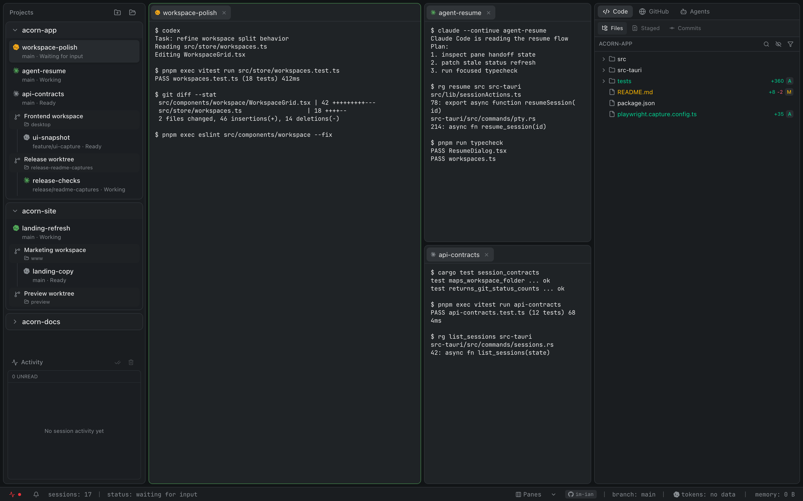
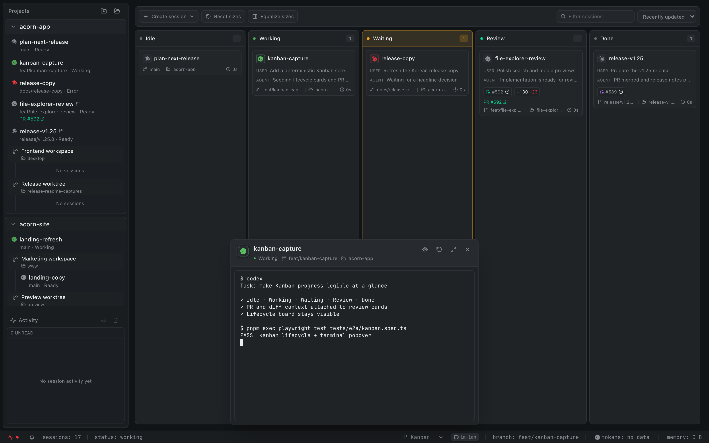
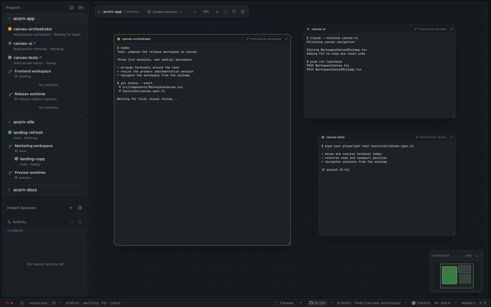
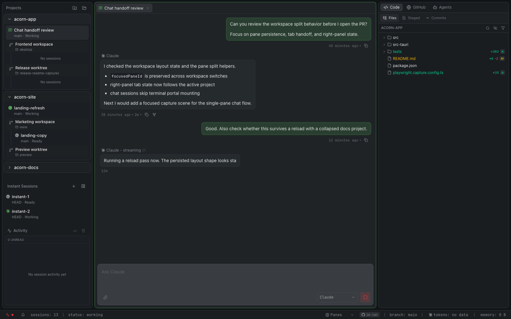
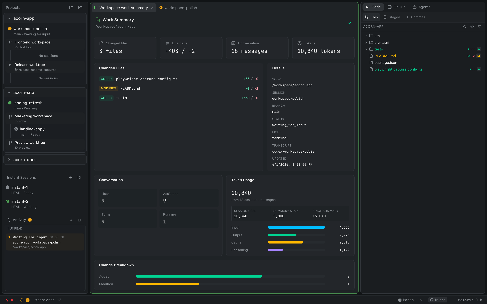
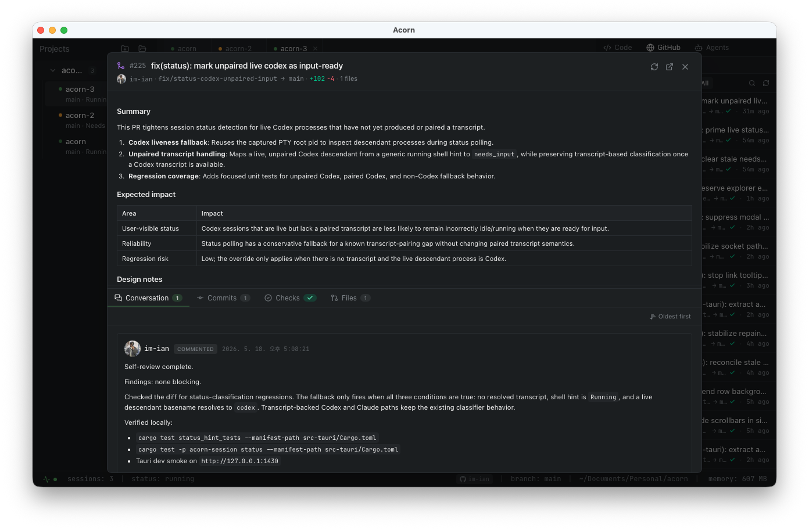

<div align="center">


# Acorn 🌰

**병렬 AI 에이전트 세션을 한 창에서.**
*Parallel AI coding agent sessions in one window — split panes, isolated git worktrees, native PTY terminals.*

AI는 강력하고 똑똑하지만, 결정과 책임은 결국 사람의 몫이죠. Acorn은 AI와 사람이 자연스럽게 협업하기 위해 만들어진 도구입니다.

[](https://tauri.app)
[](https://react.dev)
[](https://www.typescriptlang.org)
[](https://pnpm.io)
[](https://www.rust-lang.org)

<br/>

<a href="https://im-ian.github.io/acorn-web/"><strong>홍보 페이지 보기</strong></a>

</div>

---

## 개요

Acorn은 여러 AI 코딩 에이전트 세션을 한 창에서 병렬로 다루는 데스크톱 앱입니다. 터미널과 채팅, 나뉜 작업 공간, 격리된 git worktree, GitHub·Linear·Jira를 한 워크스페이스에 둡니다.

---

## 스크린샷

<div align="center">
  
  <br/>
  <sub>메인 워크스페이스 — 사이드바 + 분할 Pane + 우측 패널</sub>
  <br/><br/>
  
  <br/>
  <sub>Kanban 워크스페이스 — 대기부터 완료까지 세션 흐름 추적</sub>
  <br/><br/>
  
  <br/>
  <sub>Canvas 워크스페이스 — 라이브 터미널을 자유롭게 배치하고 한눈에 탐색</sub>
  <br/><br/>
  
  <br/>
  <sub>네이티브 채팅 — 터미널 없이 Claude / Codex / Antigravity / Grok과 대화</sub>
  <br/><br/>
  
  <br/>
  <sub>작업 요약 — 변경 파일·대화 턴·토큰 사용량을 한 탭에서 집계</sub>
  <br/><br/>
  
  <br/>
  <sub>PR 상세 모달 — 체크 상태 + 변경 사항 + 머지 옵션</sub>
</div>

---

## 주요 기능

### 워크스페이스
세션은 나뉜 Pane, Kanban(대기 → 완료), Canvas로 봅니다. 탭은 드래그로 옮기고, 보이는 터미널에는 입력을 한 번에 넣을 수 있습니다. 쓰지 않는 탭은 최소화하거나 보관하고, 보관한 세션은 다시 열 수 있습니다.

### 프로젝트와 git worktree
프로젝트를 만들거나 기존 저장소를 엽니다. 한 프로젝트가 여러 저장소 루트를 품을 수 있고, 세션은 격리된 worktree에서 같은 저장소를 동시에 작업할 수 있습니다. 프로젝트에 묶이지 않은 터미널은 사이드바 **인스턴트 세션**에서 바로 시작합니다.

### AI 에이전트
세션은 네이티브 셸로 시작합니다. 그 안에서 Claude Code, Codex, Antigravity, Grok, Ollama, llm을 실행하거나, 터미널 없이 채팅할 수 있습니다. 대화 fork, 탭 제목 자동 생성, 사이드바 상태(준비됨 / 작업 중 / 입력 대기 / 오류)를 제공합니다. 이전 대화는 이어하기를 제안하고, 설정하면 앱 시작 시 자동으로 resume합니다.

### Graph와 Loop
Graph는 프롬프트를 실행 그래프로 나누거나, Agent / Validator / Merge / Human 노드로 DAG를 직접 그립니다. Loop는 Claude 또는 Codex가 격리 worktree에서 계획부터 PR까지 진행하고, 단계마다 자동 진행·먼저 확인·사용 안 함을 고릅니다.

### 꺼지지 않는 터미널과 세션 IPC
백그라운드 세션은 앱을 닫았다가 열어도 PTY를 유지합니다. 세션 안의 에이전트는 `acorn-ipc`로 같은 프로젝트의 다른 세션을 조작할 수 있습니다. Claude Code 자동 모드는 이 명령을 기본으로 거절하므로, 쓰려면 `/permissions`에서 `Bash(acorn-ipc *)`를 허용합니다. 사용법과 보안 모델은 [`docs/SESSION_IPC.md`](docs/SESSION_IPC.md)에 있습니다.

### 코드, GitHub, 이슈
우측 패널에서 프로젝트 메모, 파일·diff·커밋, GitHub PR·이슈·Actions, 연결한 Linear·Jira 이슈를 봅니다. 메모·PR·이슈에서 **작업 시작**을 하면 격리 worktree와 에이전트가 열립니다. **스케줄**은 주기적으로 돌릴 에이전트 작업을 등록해 정한 시각(간격·매일·매주)에 — 앱이 켜져 있는 동안 — 실행합니다. 대화형 세션으로 띄울지 `-p` 처럼 한 번 답하고 끝낼지 고르고, 탭을 열지 않는 **백그라운드 실행**(acornd 데몬 필요)도 선택할 수 있습니다. 현황판 탭의 실행 기록에서 세션을 열거나 에이전트가 남긴 작업 요약을 읽고, 쌓인 기록은 한 번에 지웁니다. 코드·이미지·PDF 뷰어, 작업 요약, 입력 대기·오류 알림도 같은 창에 있습니다.

`⌘P` 커맨드 팔레트, `⌘T` 새 세션, `⌘,` 설정. `⌘`는 Windows·Linux에서 `Ctrl`입니다. 나머지 단축키는 Settings → Shortcuts에서 바꿉니다. 언어는 English / 한국어 / 日本語 / 简体中文이고, 테마·터미널·에이전트·Linear/Jira·알림도 설정에서 바꿉니다. macOS·Windows는 앱 안에서 업데이트합니다.

---

## 설치

### Windows 10/11 (x64)

[Releases](https://github.com/im-ian/acorn/releases/latest)에서 `Acorn_*_x64-setup.exe`를 내려받아 실행합니다. NSIS 설치 프로그램은 현재 사용자 영역에 설치되므로 관리자 권한이 필요하지 않으며, 이후 업데이트는 앱 안에서 받을 수 있습니다.

> 현재 Windows 설치 프로그램은 Tauri updater 서명으로 업데이트 무결성을 검증하지만 Authenticode 코드 서명은 적용되지 않았습니다. 브라우저에서 내려받으면 Microsoft Defender SmartScreen이 **알 수 없는 게시자** 경고를 표시할 수 있습니다. 공식 `im-ian/acorn` Releases URL에서 받은 파일인지 확인한 뒤 실행하세요.

### macOS

#### 설치 스크립트

```bash
curl -fsSL https://raw.githubusercontent.com/im-ian/acorn/main/scripts/install-macos.sh | bash
```

최신 릴리스 DMG를 내려받아 `/Applications/Acorn.app`에 복사하고 quarantine 속성을 제거합니다. 위치를 바꾸려면 `ACORN_INSTALL_DIR`를 지정:

```bash
curl -fsSL https://raw.githubusercontent.com/im-ian/acorn/main/scripts/install-macos.sh \
  | ACORN_INSTALL_DIR="$HOME/Applications" bash
```

#### 수동 DMG

[Releases](https://github.com/im-ian/acorn/releases/latest)에서 `Acorn_*_aarch64.dmg`(Apple Silicon) 또는 `Acorn_*_x64.dmg`(Intel)를 받아 `Applications`로 복사한 뒤 quarantine 속성 제거:

```bash
xattr -dr com.apple.quarantine /Applications/Acorn.app
```

> Acorn은 Apple Developer ID로 서명·공증되지 않은 ad-hoc 빌드입니다. 위 명령은 Gatekeeper의 quarantine 플래그만 떼는 단계로 앱 무결성에는 영향이 없습니다.

---

## 소스에서 빌드

요구사항: **pnpm** 9.x, **Rust** stable, **Xcode CLT**(macOS) 또는 **Microsoft C++ Build Tools + WebView2**(Windows) 등 [OS별 Tauri 사전 요구사항](https://v2.tauri.app/start/prerequisites/).

```bash
pnpm install
pnpm run build:sidecar  # acorn-ipc + acornd 사이드카 빌드 (최초 1회 + IPC/daemon 변경 시)
pnpm run tauri dev      # 개발 모드
pnpm run tauri build    # 프로덕션 빌드
```

> ℹ️ `pnpm run tauri dev` / `tauri build`는 `src-tauri/binaries/acorn-ipc-<target-triple>[.exe]`, `acornd-<target-triple>[.exe]` 파일이 존재해야 시작합니다. 이 경로는 `.gitignore`에 포함돼 있어 fresh checkout(특히 `git worktree add`로 만든 worktree)에서는 비어 있고, 미리 빌드하지 않으면 `resource path 'binaries/...' doesn't exist` 에러로 빌드가 실패합니다. `pnpm run build:sidecar`가 호스트 타깃에 맞는 두 바이너리를 빌드하고 올바른 위치에 stage합니다.

개발 모드의 런타임 데이터는 설치된 앱과 분리되어 OS별 Acorn application-data 디렉터리의 `profiles/dev/`에 저장됩니다. 프로덕션 빌드는 `profiles/prod/`. 임시 격리가 필요하면 `ACORN_PROFILE=<name>` 또는 `ACORN_DATA_DIR=<path>`로 앱·IPC CLI·daemon이 볼 데이터 디렉터리를 바꿀 수 있습니다.

### 테스트

```bash
pnpm run test       # Vitest
pnpm run test:e2e   # Playwright
```

기여 가이드는 [`CLAUDE.md`](CLAUDE.md) 참고.

---

## 제작자

🐿️ by [@im-ian](https://github.com/im-ian) — issues / PRs welcome.
